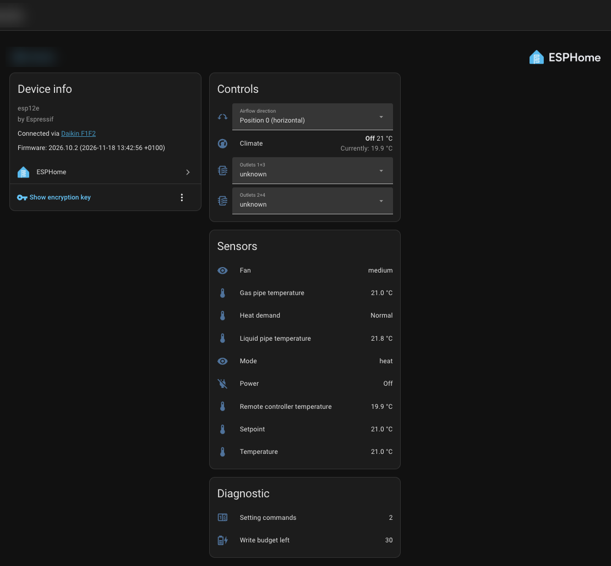
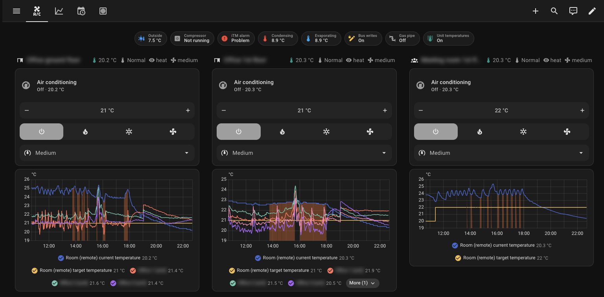
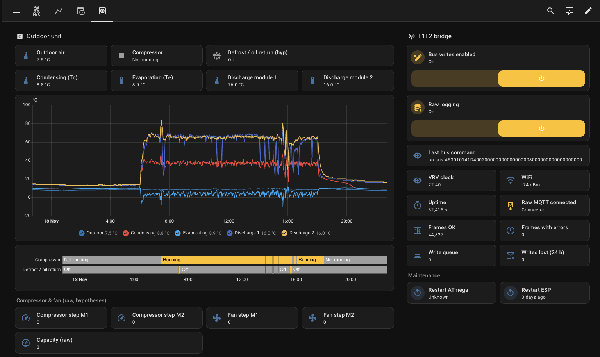

# Daikin F1F2 (DIII-NET) for ESPHome

An ESPHome external component that reads and controls a Daikin VRV system through its
F1F2 bus (DIII-NET), the two-wire bus the outdoor unit, the indoor units and a central
controller such as the Daikin iTM share. It runs on a
[P1P2MQTT bridge](https://github.com/Arnold-n/P1P2MQTT) and shows up in Home Assistant as
one device per indoor unit, with a climate entity per remote-control group.

This component is not made or supported by Daikin. Daikin does not publish the DIII-NET
protocol: everything here was worked out from bus logs of one system (see
[docs/protocol.md](docs/protocol.md)). Read the [known limitations](#known-limitations)
before you let it write to your bus.

## What you get

Per remote-control group (configured on the group master):

| Entity | What it does |
| --- | --- |
| **Climate** | Off, heat, cool, fan only; fan auto/low/medium/high; setpoint 16-32 °C in whole degrees. Auto and dry set elsewhere are shown, but can't be set from here. One command switches the whole group. |
| **Airflow direction** (select) | Swing, or a fixed flap position from *Position 0 (horizontal)* to *Position 4 (down)*. |
| **Setpoint**, **Fan**, **Mode** (sensors) | The group's settings as the bus reports them. |
| **Remote controller temperature** | The sensor in the wired remote. The climate's current temperature uses it when there is one. |
| **Liquid / gas pipe temperature** | The indoor coil's refrigerant pipes. |
| **Setting commands**, **Write budget left** (diagnostic) | Setting commands seen on the bus for this group (from any controller), and how many more this bridge may send now (see [Controlling units](#controlling-units)). |

Per indoor unit:

| Entity | What it does |
| --- | --- |
| **Temperature** | Return air at the unit. |
| **Power**, **Mode** | As the unit reports them. |
| **Heat demand** | The unit's own thermostat asks for heat (status bit `0x20`). |
| **Outlets 1+3**, **Outlets 2+4** (selects) | Per-outlet flap setting of 4-way cassettes, by pair of opposite outlets: *Normal* or *Fixed (0)*. Write-only (see [limitations](#known-limitations)). |

For the system:

| Entity | What it does |
| --- | --- |
| **Outdoor temperature** | Outdoor air at the outdoor unit. |
| **Evaporating / condensing temperature** | Te and Tc of the refrigerant circuit. |
| **Discharge temperature** per outdoor module | Compressor discharge *(hypothesis)*. |
| **Compressor** | Running or not. |
| **Defrost or oil return** | An outdoor module in the state seen during defrost *(hypothesis)*. |
| **System clock** | The VRV's own clock. |
| Diagnostics | Bus frames OK / with errors, write queue, last bus command, compressor and fan steps and a capacity value (raw, partly guessed). |

A Daikin hydrobox on the same bus gets its temperature, power, heat demand and a *heat
demand step* (0-15) sensor, and a climate that switches it on and off and between heat
and cool. It has no target temperature: the leaving-water setpoint isn't decoded.

Switches: *Bus writes enabled* (off = read-only), *ATmega programming* (see
[docs/atmega.md](docs/atmega.md)) and *Raw logging* (only with `raw_mqtt`). A button
restarts the ATmega.

## Screenshots

A group master in Home Assistant: the climate, airflow and outlet selects, the group's
sensors and the write budget.



A dashboard built from these entities, with a climate and a temperature history per
group. The dashboard itself isn't part of this repository.



The system view of the same dashboard: outdoor unit temperatures and compressor state,
and the bridge's switches and bus diagnostics.



## Hardware

A [P1P2MQTT bridge](https://github.com/Arnold-n/P1P2MQTT) v1.2 or v1.3 (ESP8266, ATmega328P
and a MAX22088 bus transceiver), connected to the F1F2 terminals of an indoor or outdoor
unit. The bridge is powered from the bus.

The ATmega runs Arnold Niessen's P1P2Monitor firmware, F1F2 build (tested with v0.9.56
and v0.9.58), and does the bus I/O. The ESP8266 runs ESPHome with this component instead
of the stock P1P2MQTT bridge firmware. See [docs/hardware.md](docs/hardware.md) for the
pins, the first install and how to go back to the stock firmware.

## Installation

Start from [example.yaml](example.yaml), a complete config for a bridge with two groups.
Copy [secrets.yaml.example](secrets.yaml.example) to `secrets.yaml` next to it and fill
it in.

It loads the component and the [packages](packages) from this repository:

```yaml
external_components:
  - source: github://casdr/esphome-daikin-f1f2@main
    components: [daikin_diii]
```

The component uses ESPHome internals and is tested with ESPHome 2026.10.2 (pinned in the
[Pipfile](Pipfile)). A newer ESPHome may need changes.

The first install on a bridge that still runs the stock firmware goes through the stock
web page; see [docs/hardware.md](docs/hardware.md#first-install).

## Configuration

Describe your system with the [ESPHome packages](https://esphome.io/components/packages/)
in [packages/](packages): the bridge once, then one package per indoor unit.

```yaml
packages:
  daikin:
    url: https://github.com/casdr/esphome-daikin-f1f2
    ref: main
    files:
      - path: packages/bridge.yaml
      - path: packages/group-master.yaml   # 1-01 has the wired remote
        vars: {id: "01", name: Daikin 1-01, area: area_living}
      - path: packages/unit.yaml           # 1-00 follows 1-01
        vars: {id: "00", group: "01", name: Daikin 1-00, area: area_living}
```

| Package | For |
| --- | --- |
| `bridge.yaml` | The bridge hardware, the bus, the system-wide entities, the switches and the research actions. Once. |
| `group-master.yaml` | The unit with the wired remote, or a unit on its own: climate, airflow, setpoint, fan, the unit's own sensors. |
| `unit.yaml` | A member of a group: temperature, power, mode, heat demand. |
| `remote-sensors.yaml` | Remote and pipe temperatures of a group master. Needs its `b1_index`. |
| `outlets.yaml` | The two outlet selects of a 4-way cassette. |
| `hydrobox.yaml` | A hydrobox: temperature, power, heat demand. |

`id` is the unit's address as two hex digits. Units are numbered on the bus as `1-00`,
`1-01` … `2-00`: `id: "00"` is `1-00`, `id: "10"` is `2-00`. You can also write the
`daikin_diii: units:` list and the entities by hand; [docs/configuration.md](docs/configuration.md)
lists every option.

The bridge logs a warning when the bus says a unit is a group master and
your table says it isn't, or the other way round.

[docs/configuration.md](docs/configuration.md) explains every option and entity, and how
to find the addresses, groups and B1 indexes of your system from a bus log.

## Controlling units

Writing is off until you turn on *Bus writes enabled*. With it on, the climate, airflow
and outlet entities send commands on the bus, as a second central controller:

- Commands use source address `0x30`. The component refuses `0x0A`, the iTM's own
  address: using it makes the iTM raise error *MC (address duplicated)*.
- Every setting command is stored in the indoor unit's non-volatile memory, which wears
  out. Daikin limits control commands to about 7000 per indoor unit per year. The
  component only sends real changes, and each group has a write budget: 30 at once, one
  more every 75 minutes. Above that a command is refused and the entity springs back.
- Commands are queued 1.5 s apart and retried when the ATmega reports a collision.

Keep automations frugal: one that changes a setpoint every 10 minutes uses a year's budget
in two to three months. [docs/writing.md](docs/writing.md) has the details, and how this
works next to an iTM or wired remotes.

## Updating the ATmega

The stock firmware can program the ATmega over the network. So can this component: turn on
*ATmega programming* and run avrdude against the bridge.

```bash
avrdude -c avrisp -P net:<bridge-ip>:328 -p m328p -U flash:w:P1P2Monitor-v0.9.58-Daikin-F1F2.ino.hex:i
```

The port only listens for 10 minutes after you turn the switch on. See
[docs/atmega.md](docs/atmega.md).

## How it works

```
F1F2 bus ── ATmega (P1P2Monitor) ──UART 250000── ESP8266 (ESPHome, daikin_diii)
                                                   ├─ native API → Home Assistant
                                                   └─ raw MQTT (optional) → P1P2/{R,E,X}/P1P2MQTT/<bridge>
```

- P1P2Monitor prints every bus frame as a text line. The component reads those lines,
  checks length and checksum and decodes the frame types it knows
  ([docs/protocol.md](docs/protocol.md)).
- Indoor units report their status in `F5` frames: right away on a change, and about once
  a minute in full. Temperatures come from these and from `B1` frames, outdoor data from
  `E9` pages.
- A command is an `A5` frame to the group master. The bus has no read-back of a command,
  so the component shows the commanded value until the next status frame confirms it, at
  most about a minute later.
- With `raw_mqtt`, every frame is also published to MQTT in the stock P1P2MQTT format
  (`R` = bus frames, `E` = errors, `X` = frames this bridge wrote), so you can log the bus
  and use the tools in [tools/](tools).

## Known limitations

- Worked out on one system: a VRV IV heat recovery outdoor unit (REYQ10T) with 16 indoor
  units in 7 groups, a hydrobox and an iTM. Other systems may use frame types or values
  this component doesn't know. The component ignores them.
- Several sensors are hypotheses: discharge temperature, compressor and fan steps,
  capacity, defrost. The protocol notes mark what is confirmed and what isn't.
- Auto and dry can't be set: their command codes are untested.
- Setpoints are whole degrees.
- The outlet selects are write-only. The units don't report the per-outlet setting on
  F1F2, so the select shows what this bridge last sent, and a change on the wired remote
  isn't seen. Only pairs of opposite outlets can be set, only to *Normal* or *Fixed (0)*,
  and only the effect on a group master has been confirmed.
- Malfunction codes are not decoded yet: no unit has been in fault while logging.
- The hydrobox's water setpoint can't be set, and *cool* hasn't been tried on a hydrobox.
  The hydrobox doesn't report its mode, so the climate shows *heat* while it's on until
  this bridge sends *cool*.
- An iTM marks a unit switched off by another controller as *setback*; switching it on and
  off once from the iTM clears that.
- Only tested on the P1P2MQTT bridge v1.2/v1.3 with an ESP8266.

## Development

Host tests need a C++17 compiler and make:

```bash
make -C tests test
```

- `units`: write guards, checksum, queue spacing and retries, the write budget over a
  simulated year, and decoder values checked by hand against real frames.
- `isp`: the ATmega programmer, a full avrdude-style session against a simulated
  ATmega328P.
- `decoder`: the C++ decoder against the Python reference over your own bus logs in
  [captures/](captures) (skipped when there are none).

`example.yaml` loads everything from GitHub. To build your local changes, write a copy
that uses this checkout, with the hydrobox package turned on as well:

```bash
python3 tests/local_example.py build/ci
esphome compile build/ci/example.yaml
```

CI ([.github/workflows/ci.yml](.github/workflows/ci.yml)) runs the host tests and that
build on every push and pull request.

The Python tools for logging and analysing the bus are in [tools/](tools)
([docs/protocol.md](docs/protocol.md) explains how they were used):

| Script | What it does |
| --- | --- |
| `f1f2_log.py` | Log raw frames from MQTT to a TSV file, with notes typed on stdin. |
| `f1f2_decode.py` | Decode a log or the live stream into a table per unit. |
| `f1f2_experiment.py` | Change-and-restore experiments: Home Assistant service calls or raw frames, logged, with a restore at the end. |
| `analyse_diff.py`, `analyse_e9.py`, `find_unknown.py` | Find changed bytes, outdoor-unit fields, and frame types not described yet. |

```bash
cd tools && pipenv install
pipenv run python f1f2_decode.py ../captures/my-log.tsv
```

Contributions are welcome, especially bus logs from other systems and anything that
confirms or corrects a hypothesis in [docs/protocol.md](docs/protocol.md).

## Credits

- [P1P2MQTT](https://github.com/Arnold-n/P1P2MQTT) by Arnold Niessen: the bridge hardware
  and the P1P2Monitor firmware this component talks to. Its firmware and hardware design
  are licensed CC BY-NC-ND 4.0 and are not part of this repository; download the firmware
  images from that project.

The component and tools are written from scratch, from the documented P1P2Monitor serial
line format and the protocol notes in this repository. They contain no P1P2MQTT code.

Claude, Anthropic's AI assistant, was used to assist during the creation of the component,
the tools and the documentation.

## License

[CC BY-NC-ND 4.0](LICENSE): free for personal use, and you may share it unmodified and
non-commercially, with attribution. Commercial use and distributing modified versions are
not allowed.
